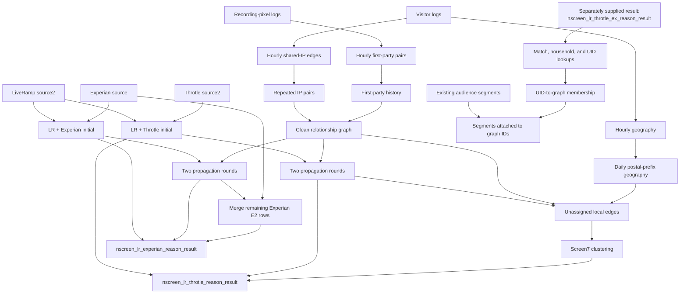

# Aggr3 NScreen: step-by-step flow guide

## What this version does

NScreen connects online identifiers into person-like groups (`matchid`) and household-like groups (`householdid`). It combines provider mappings with evidence from activity logs. Other tasks turn those groups into lookup tables and attach audience segments to them.

**This directory contains two identity-building branches, plus a separate publication path.** They share code and tables, but they are not one continuous three-provider pipeline.

| Component | Entry point | Result or input |
| --- | --- | --- |
| Shared hourly evidence | `NScreenIpColocationHourlyRunner` | IP relationships, first-party relationships, geography |
| LiveRamp + Throtle branch | `NScreenIpColocationDailyRunner` | Writes `crossscreen.nscreen_lr_throtle_reason_result` |
| LiveRamp + Experian branch | `NScreenExperianDailyRunner` | Writes `crossscreen.nscreen_lr_experian_reason_result` |
| Lookup publication | `NScreenCleanMurmurRunner` | Reads `crossscreen.nscreen_lr_throtle_ex_reason_result` |
| Segment expansion | `NScreenAllSegmentsRunner` | Reads published lookup tables; writes graph-level segments |

Notice the third result name: **`nscreen_lr_throtle_ex_reason_result` is consumed here, but neither identity branch in this directory produces it.** Forge produces this combined result; see the separate [NScreen Graph guide](graph-pipeline.md#final-result). Trino metadata inspected on 2026-10-13 resolves both `hms_ma2_adhoc.crossscreen.nscreen_lr_throtle_ex_reason_result` and `iceberg.crossscreen.nscreen_lr_throtle_ex_reason_result` to the same Iceberg table and HDFS location. The same catalog redirection applies to `health.npiiddaily`. Executable metadata checks and a real IQ segment example are included in [the IQ notebook walkthrough](../../iq-trace/iq-to-nscreen-segment.ipynb), with saved results and optional live reruns, and in [the SQL version](../../iq-trace/iq-to-nscreen-segment.sql).

### Scope and evidence

This guide describes the local `aggr3/aggr/flows/thirdparty/nscreen/` source, reviewed on **2026-10-12**, at Aggr3 commit `a845a8d16b53706e6ec67c8b907d8ffa10d014bf`. It follows executable SQL and task dependencies, including inherited methods. File links point to the local checkout.

This guide combines source analysis with the selected warehouse checks recorded in the IQ SQL walkthrough dated 2026-10-13. That trace verifies catalog resolution and a concrete published segment; it does not establish every deployed task or historical invocation parameter. Live schedules and deployed Hive function implementations were not inspected. The repository [README](../../../aggr3/README.md) places deployment in a separate repository. A class being present here does not establish that it is scheduled today.

## Vocabulary

| Term | Meaning in this flow |
| --- | --- |
| `uid` | Cookie, device advertising ID, EID, or synthetic provider identifier. It is not necessarily a person. |
| Edge | A relationship between two UIDs, stored as `uid1`, `uid2`. |
| `weight` | Strength accumulated from observations. It is not a probability. |
| `samedevice` | Device-compatibility evidence supplied by a Hive function, or forced true for first-party links. |
| `differentusers` | A conflict clue supplied by a Hive function. Not every later stage uses it. |
| `matchid` | Person-like grouping identifier, usually a hashed provider ID or a clustering result. |
| `householdid` | Household-like grouping identifier. It can be missing. |
| Seed | A UID that already has a provider-derived assignment. |
| Propagation | Assigning an unassigned UID to a group supported by its graph neighbors. |
| `stable` | A branch-specific preference flag. It is not a guarantee of identity correctness or day-to-day stability. |
| `reason` | Assignment provenance, such as `LR`, `TH`, `EX`, `IC`, or `LU`. |

Two UIDs sharing a network do not necessarily belong to the same person. The flow uses repeated observations, provider evidence, and limits to make that inference more selective.

## Overall map

Solid arrows below describe reads and transformations in this directory. The publication input is shown separately because the local producers write different tables.



## Part 1 — Build shared relationship evidence

### Step 1. Select eligible hourly observations

Task: [`NScreenRawHourlyTask`](../../../aggr3/aggr/flows/thirdparty/nscreen/nscreen.py#L86).

Input: `fact.visitorlogevent`, for one `day` and `hour`.

The task combines two sources of UID values from those events:

1. `coalesce(visitorguid, deviceid)`.
2. Individual EIDs split from the pipe-delimited `eids` field.

It normalizes IP addresses with `default.normalize_ip_address`, then applies these filters:

| Rule | Value |
| --- | --- |
| Countries | `USA`, `DEU`, `ESP`, `FRA`, `GBR`, `ITA` |
| UID format | Configured `uid_regex`, length 11–512, restricted characters |
| Invalid UID pattern | Reject values made only from the configured `0`, `1`, and punctuation set |
| Excluded NAICS | `517112`, `518210`; null NAICS remains eligible |
| Distinct UIDs per IP per hour | Between **2 and 8**, inclusive |

For an eligible IP with `N` distinct UIDs, each UID receives weight `1/N`. An IP with two UIDs contributes `0.5`; an IP with eight contributes `0.125`.

Output: `crossscreen.nscreen_raw_hourly`, one row per `(ip, uid)` within the hour. The SQL selects maximum user-agent and location values during aggregation; these are representative values, not a most-frequent-device calculation. Country and postal code are first aggregated at IP level.

**Small SQL detail:** `coalesce` falls back on null, not on an empty string. An empty `visitorguid` does not automatically fall through to `deviceid`.

### Step 2. Parse user agents and create IP edges

Tasks: [`NScreenUaHourlyTask`](../../../aggr3/aggr/flows/thirdparty/nscreen/nscreen.py#L175) and [`NScreenIpColocationHourlyUaTask`](../../../aggr3/aggr/flows/thirdparty/nscreen/nscreen.py#L225).

First, `default.parse_ua` extracts device class, device name, OS/version, and browser/version into `crossscreen.nscreen_ua_hourly`.

Next, the raw table joins to itself on IP. The condition `uid1 < uid2` keeps one orientation of each pair and excludes self-pairs. Contributions are summed across shared IPs in that hour.

The task calls:

- `default.is_same_device(...)` to produce `samedevice`.
- `default.different_users(...)` to produce `differentusers`.

Output: `crossscreen.nscreen_ipcolocation_hourly_ua` with `(uid1, uid2, weight, samedevice, differentusers)`.

These Hive functions contain rules outside this Python directory. Their names describe their intended role; the precise device-class rules cannot be recovered from these call sites alone.

### Step 3. Capture first-party pairs independently

Task: [`NScreenFirstPartyCollocationHourly2Task`](../../../aggr3/aggr/flows/thirdparty/nscreen/nscreen.py#L619).

Input: `fact.recordingpixellogevent` for the same hour. This is a separate route from shared-IP evidence.

For each recording-pixel `guid`, collect:

1. `visitorguid`, only when `visitorstatus = 3`.
2. `deviceifa`, only when length is 36 and it is not the all-zero UUID.
3. EIDs whose prefix is `FP`, `MA`, or `I5`.

Join identifiers sharing that event GUID, keep `uid1 < uid2`, and deduplicate the pair within the hour.

Output: `crossscreen.nscreen_1p_collocation_hourly2`.

For example, a qualifying recording event containing a cookie and mobile ID creates a direct pair. It does not need to pass the shared-IP group-size test. The country, NAICS, and generic UID-regex filters from Step 1 are not applied here.

### Step 4. Keep repeated IP relationships and count first-party history

Tasks: [`NScreenIpColocationDailyAllUaTask`](../../../aggr3/aggr/flows/thirdparty/nscreen/nscreen.py#L343) and [`NScreenFirstPartyCollocationDailyTask`](../../../aggr3/aggr/flows/thirdparty/nscreen/nscreen.py#L682).

For target date `D`:

| Evidence | SQL date interval | Aggregation | Eligibility |
| --- | --- | --- | --- |
| Shared IP | `D − 25` through `D`, inclusive | Sum weights; maximum `samedevice`; minimum `differentusers` | Observed on at least **3 distinct dates** |
| First-party | `D − 365` through `D`, inclusive | `count(1)` per pair | No corresponding three-date minimum |

These intervals allow **26** and **366** calendar dates respectively, subject to available retained partitions. They are SQL bounds, not guarantees of complete history.

The IP threshold is named `min_hours = 3`, but the SQL counts **days**, not hours. Seeing a pair during three hours on one date is insufficient.

First-party hourly pairs were already deduplicated. Their daily weight therefore counts stored pair-hour rows, not raw recording events. Ten events yielding the same pair in one hour contribute one row.

Outputs:

- `crossscreen.nscreen_ipcolocation_daily_all_ua`.
- `crossscreen.nscreen_1p_collocation_daily2`.

There is no intervening one-day IP aggregation task in this directory: the multi-day query reads hourly edges directly.

### Step 5. Combine and prune the relationship graph

Task: [`NScreenIpCollocationDailyCleanTask`](../../../aggr3/aggr/flows/thirdparty/nscreen/nscreen.py#L553).

The task unions both evidence sources. First-party rows receive `samedevice = true` and `differentusers = false`.

For repeated `(uid1, uid2)` pairs it takes:

- Maximum weight, rather than adding IP and first-party weights.
- Maximum `samedevice`.
- Maximum `differentusers`.

Thus, first-party evidence can make `samedevice` true without erasing a true conflict flag from the aggregated IP evidence. Both flags can coexist.

It then ranks edges twice:

1. Within `uid1`, by descending weight and descending `uid2`.
2. Within `uid2`, by descending weight and descending `uid1`.

Keep edges ranked at most **10 on both sides**.

Output: `crossscreen.nscreen_ipcollocation_daily_clean`.

**This is not a strict ten-neighbor limit per UID.** Because edges are stored in lexical order, a UID can occur on both sides. It can retain up to ten edges as `uid1` and ten as `uid2`. The cleaning rank uses weight; it does not explicitly prioritize `samedevice`.

### Step 6. Choose geography for later clustering

Tasks: [`NScreenGeoHourlyTask`](../../../aggr3/aggr/flows/thirdparty/nscreen/nscreen.py#L295) and [`NScreenGeoDailyTask`](../../../aggr3/aggr/flows/thirdparty/nscreen/nscreen.py#L1200).

Hourly geography comes from the eligible raw observations. Blank UID, country, and postal code values are removed.

The daily query reads `D − 25` through `D`, then:

1. Takes the first three postal-code characters as `geo`.
2. Counts rows per UID and postal prefix.
3. Selects the most frequent prefix.
4. Breaks tied counts with `max(geo)`.

Output: `crossscreen.nscreen_geo_daily_ua`.

Country is not included in the daily grouping key. Equal prefixes are therefore not proof of geographic proximity across countries. This geography constrains the LiveRamp/Throtle remainder; it does not constrain ordinary propagation.

## Part 2 — LiveRamp + Throtle identity branch

### Step 7. Normalize provider mappings

Tasks: [`NScreenThrotleRawTask`](../../../aggr3/aggr/flows/thirdparty/nscreen/nscreen.py#L723), [`NScreenThrotleSource2Task`](../../../aggr3/aggr/flows/thirdparty/nscreen/nscreen.py#L791), and [`NScreenLiverampSource2Task`](../../../aggr3/aggr/flows/thirdparty/nscreen/nscreen.py#L861).

| Provider | Inputs | Source-date selection |
| --- | --- | --- |
| Throtle | `throtle.maid`, `throtle.pulsepoint_cookie`, `throtle.householdid_mapping` | Latest MAID and household partitions; cookies from the latest monthly partition date onward |
| LiveRamp | `thirdparty.liveramp_id_mapping_flat` | Latest available partition |

The Throtle cookie query has no upper date bound and does not restrict all selected rows to `type = 'monthly'`. The monthly partition establishes its starting date.

Both provider transformations:

1. Associate observed UIDs with provider person IDs.
2. Retain household IDs only when the household contains more than one distinct provider person ID.
3. Hash person and retained household IDs using `default.murmur3`.
4. Add a synthetic UID for each provider person ID: `TH_<throtleid>` or `LR_<rampid>`.

LiveRamp additionally requires Ramp ID length greater than 20 and observed UID length greater than 11 but less than 40. Ramp IDs beginning `XY` receive `stable = true`.

Outputs: `crossscreen.throtle_source2` and `crossscreen.liveramp_source2`.

Synthetic UIDs make provider identities addressable within the mapping. Hashing converts identifiers into numeric keys; it does not provide additional identity evidence.

### Step 8. Align Throtle groups to LiveRamp groups

Task: [`NScreenLiverampThrotleInitialReasonStageTask`](../../../aggr3/aggr/flows/thirdparty/nscreen/nscreen.py#L934).

Shared UIDs reveal overlap between provider groups. The query counts joined rows for each `(throtle_matchid, liveramp_matchid)` pair, then accepts a mapping only when it is:

1. Highest ranked for that Throtle group.
2. Highest ranked for that LiveRamp group.
3. Untied at that rank in both directions.

This is **unique mutual-best alignment**. Counts are joined-row counts, not explicitly distinct-UID counts.

Accepted mappings retain the LiveRamp match ID, household ID, and stability flag. All LiveRamp rows remain. Throtle rows whose UID already exists in LiveRamp are removed from the Throtle side, regardless of whether their group alignment was accepted.

For remaining Throtle-only UIDs:

- Accepted group alignment → use the mapped LiveRamp assignment, reason `LRTH`.
- No accepted alignment → keep the Throtle assignment, reason `TH`, with `stable = true`.

LiveRamp groups with accepted alignment receive `LRTH`; other LiveRamp groups receive `LR`.

Output: `crossscreen.nscreen_liveramp_throtle_reason_staged`, partition `stage = 'initial'`.

### Step 9. Select seeds connected to observed relationships

Task: [`NScreenLiverampThrotleConnectedNsStageTask`](../../../aggr3/aggr/flows/thirdparty/nscreen/nscreen.py#L1035).

Keep initial UIDs appearing at either endpoint of the clean graph. Write them to `stage = 'connected_ns'`.

This subset seeds propagation. Initial provider rows outside the graph are still retained in the final result. The SQL uses an intermediate `N\A` reason literal; final output reads `initial`, not these seed-copy rows.

### Step 10. Fill unassigned neighbors in two rounds

Task: [`NScreenLiverampThrotleStageNStageTask`](../../../aggr3/aggr/flows/thirdparty/nscreen/nscreen.py#L1089), run for stages 1 and 2.

Each round:

1. Duplicates each clean edge in reverse, allowing travel in either direction.
2. Joins neighboring UIDs to connected seeds and earlier propagation results.
3. Sums supporting weights per `(uid, matchid, householdid, stable)` candidate.
4. Doubles scores for stable candidates.
5. Excludes UIDs already assigned in those seed/prior-stage rows.
6. Chooses one candidate per UID: highest score, then highest numeric match ID.
7. Keeps at most ten winning UIDs per match ID: highest score, then descending UID.
8. Writes reason `IC`.

Stage 1 can reach direct seed neighbors. Stage 2 also uses stage-1 assignments and can reach one further hop.

Three consequences matter:

- **Existing groups are not reconciled.** An edge between two already assigned UIDs does not merge their match IDs.
- **Ten is a per-round expansion cap.** It is not a total group-size limit, and it excludes existing provider membership.
- **There is no fallback after the cap.** A UID rejected because its chosen match ID already has ten stronger winners does not retry its second-best candidate in that round.

Propagation reads only edge endpoints and weights. It does not directly inspect `samedevice`, `differentusers`, or geography. Even first-party-supported propagation receives reason `IC`.

### Step 11. Select unassigned local relationships

Task: [`NScreenIpCollocationDailyRemainderTask`](../../../aggr3/aggr/flows/thirdparty/nscreen/nscreen.py#L1261).

Starting from clean edges, remove every edge with either endpoint assigned in `initial`, `stage1`, or `stage2`. Require geography for both remaining endpoints and require equal `geo` values.

Output: `crossscreen.nscreen_ipcollocation_daily_remainder`.

This is an edge remainder, not a complete list of unassigned UIDs. Isolated UIDs, missing-geography UIDs, and UIDs left only with excluded edges do not enter clustering through this query.

### Step 12. Cluster that remainder

Task: [`NScreenRemainderStageTask`](../../../aggr3/aggr/flows/thirdparty/nscreen/nscreen.py#L1310).

Within each `geo`, SQL calls:

```sql
default.calc_screen7_ids_udaf(
    default.murmur3(uid1),
    default.murmur3(uid2),
    weight,
    samedevice,
    differentusers
)
```

The aggregate returns `(uidhash, deviceid, matchid, householdid)` assignments. SQL joins hashes back to original UID strings, discards the returned `deviceid`, and writes `stable = false`, reason `LU`, to `stage = 'louvain'`.

The module describes household grouping followed by Louvain person grouping. The executable clustering algorithm lives in the external Hive aggregate. Exact internal limits and conflict rules require checking the deployed implementation. The separate [Screen7 grouping guide](../udaf-calc-screen7-ids-evaluator.md) provides background, but this review does not establish that its Java version matches the deployed Aggr3 function.

### Step 13. Assemble the LiveRamp/Throtle result

Task: [`NScreenLrThrotleReasonResultTask`](../../../aggr3/aggr/flows/thirdparty/nscreen/nscreen.py#L1391).

Read `initial`, `stage1`, `stage2`, and `louvain` together, then:

- Prefix stable match IDs and nonzero household IDs with `S_`.
- Convert household ID zero to an empty string; null remains null.
- Remove zero match IDs.
- Remove banned UID patterns.
- Remove synthetic `LR_` UIDs when their reason is `IC`.

Output: **`crossscreen.nscreen_lr_throtle_reason_result`**, partitioned by `day`, with `uid`, `matchid`, `householdid`, and `reason`.

This final select does not enforce one distinct assignment per UID. Provider-source multiplicity can survive upstream processing.

## Part 3 — LiveRamp + Experian identity branch

This branch reuses the clean relationship graph and LiveRamp source, but changes provider precedence and the final expansion step. It does not incorporate Throtle mappings or run remainder clustering.

### Step 14. Normalize Experian and separate two kinds of rows

Task: [`NScreenExperianSourceTask`](../../../aggr3/aggr/flows/thirdparty/nscreen/nscreen_experian.py#L38).

Input: `experian.digital_graph`, with **no day predicate** in the source query.

Accepted identifier types:

- `PULSEPOINT`
- `HARDWARE_IDFA`
- `HARDWARE_ANDROID_AD_ID`
- `HARDWARE_TV`
- `TAPAD_COOKIE`

The raw match key is `coalesce(pid, ip, household_id)`, which is hashed into `matchid`. A nonempty household ID is hashed separately. Tapad cookie UIDs receive `TA_`; additional synthetic UIDs use `EP_<pid>` and `EL_<luid>`.

Output: `crossscreen.experian_source`, including `pid`, `luid`, household and individual quality scores, and `personidtype`.

Downstream tasks split it into:

| Subset | Condition | When used |
| --- | --- | --- |
| Initial Experian | Nonempty `pid` **or** nonempty `luid` | Before propagation |
| `e2` | Both `pid` and `luid` null/empty | After propagation |

The code carries quality scores but applies no quality-score cutoff here. Also, `coalesce` skips nulls rather than empty strings: an empty `pid` can prevent fallback to IP and cause the source row to fail the nonempty raw-key check.

### Step 15. Map LiveRamp groups toward Experian

Task: [`NScreenLiverampExperianInitialReasonStageTask`](../../../aggr3/aggr/flows/thirdparty/nscreen/nscreen_experian.py#L115).

Join initial Experian and LiveRamp rows on UID, then count overlap per pair of match IDs. For **each LiveRamp match ID**, select the Experian match ID with greatest overlap using `row_number()`.

This differs materially from Step 8:

| Rule | LiveRamp + Throtle | LiveRamp + Experian |
| --- | --- | --- |
| Preferred assignment | LiveRamp | Experian |
| Alignment | Unique mutual best | One best Experian candidate per LiveRamp ID |
| Equal overlap | Reject ties | Select one; no explicit tie-breaker |
| Multiple source groups mapping to one preferred group | Restricted by mutual-best rule | Multiple LiveRamp groups may map to one Experian group |
| Shared UID precedence | Keep LiveRamp side | Keep Experian side |
| Stability | Preserve branch-specific flags | Force all rows false |

All initial Experian rows remain. LiveRamp rows whose UID already exists in initial Experian are excluded from the LiveRamp side. Other LiveRamp UIDs inherit the selected Experian match and household IDs when available; otherwise they retain their LiveRamp assignment.

Reasons are `EX`, `LR`, and `LREX`. Output goes to `crossscreen.nscreen_liveramp_experian_reason_staged2`, `stage = 'initial'`.

**Multiplicity caveat:** joining Experian rows to a mapping containing several LiveRamp groups for the same Experian group can duplicate those Experian rows. There is no distinct operation at this join. Those copies can subsequently multiply propagation support; this guide does not assume they are harmless.

### Step 16. Propagate twice, without the stability bonus

Tasks: [`NScreenLiverampExperianConnectedNsStageTask`](../../../aggr3/aggr/flows/thirdparty/nscreen/nscreen_experian.py#L198) and [`NScreenLiverampExperianStageNStageTask`](../../../aggr3/aggr/flows/thirdparty/nscreen/nscreen_experian.py#L243).

The process follows Steps 9–10: connected seeds, reversed edges, weighted candidate selection, already-assigned exclusion, and ten new UIDs per match ID per round.

Here scores are plain sums of weights. Every result has `stable = false`, and propagated rows receive `IC`. The two rounds still fill gaps rather than merging already assigned groups.

### Step 17. Add remaining Experian E2 rows

Task: [`NScreenLiverampExperianE2MergeStageTask`](../../../aggr3/aggr/flows/thirdparty/nscreen/nscreen_experian.py#L324).

Let `g` be all assignments from `initial`, `stage1`, and `stage2`.

1. Take Experian rows without either `pid` or `luid`.
2. Find shared UIDs between these E2 groups and `g`.
3. Count support per `(e2_matchid, g_matchid)`.
4. Choose one strongest existing `g_matchid` for each E2 match ID.
5. Add only E2 UIDs not already present in `g`.
6. Use the selected existing assignment, or retain the E2 assignment when no overlap mapping exists.

Output: `stage = 'e2_merge'`, reason `EX`, stability false.

Ties again have no explicit secondary ordering. This stage uses provider-group overlap, not clean-graph clustering, and has no equivalent ten-new-UID cap. It runs after both propagation rounds; newly added E2 members do not seed another round.

### Step 18. Produce the Experian result and metadata

Task: [`NScreenLrExperianReasonResultTask`](../../../aggr3/aggr/flows/thirdparty/nscreen/nscreen_experian.py#L423).

Combine `initial`, `stage1`, `stage2`, and `e2_merge`, applying the same zero-ID and UID cleanup pattern. Although the formatting supports `S_`, all assignments generated by this branch have stability false.

Join Experian metadata back **by UID**, then compute `max(pid)` and `max(luid)` over each final match ID. Those fields can therefore populate other rows in the same group. Each maximum is chosen independently; this does not select one coherent highest-quality Experian record.

Quality scores and `personidtype` remain from the UID-level join. A UID absent from Experian can inherit a group-level `pid` or `luid` while retaining null quality-score fields. Multiple Experian rows for one UID can multiply output rows.

Output: **`crossscreen.nscreen_lr_experian_reason_result`** with:

```text
day, uid, matchid, householdid, reason,
pid, luid, household_quality_score,
individual_quality_score, personidtype
```

There is **no `louvain` stage** in this result. A UID with only unseeded relationship evidence can receive a new group in the LiveRamp/Throtle branch, yet remain absent from this branch unless Experian E2 supplies it.

## Worked example: following a few UIDs

These symbolic UIDs and match IDs are illustrative. Assume their real equivalents pass source filters, and all mentioned edges survive cleaning.

### Common propagation behavior

```text
cookie_A (seed M1) — mobile_B — cookie_C — device_D

cookie_E (seed M2) — cookie_A (seed M1)
```

| Point in processing | Result |
| --- | --- |
| Initial | `cookie_A → M1`; `cookie_E → M2` |
| Stage 1 | `mobile_B → M1`, provided M1 wins scoring and capacity |
| Stage 2 | `cookie_C → M1`, under the same conditions |
| After two rounds | `device_D` has no assignment through this three-hop path |
| Existing-group edge | `cookie_E` remains M2; its edge to `cookie_A` does not merge M2 into M1 |

If candidate M1 receives score 4 and M2 score 6, a stable M1 scores 8 in the LiveRamp/Throtle branch and can win. In the Experian branch, there is no bonus, so M2 wins on these weights.

### How provider alignment changes the answer

Suppose two LiveRamp groups overlap the same Experian group:

```text
LiveRamp L1 → Experian E1: 4 supporting rows
LiveRamp L2 → Experian E1: 2 supporting rows
```

If E1 is each LiveRamp group's best candidate, **both L1 and L2 can map to E1** in the Experian branch. Mutual-best alignment would impose a different restriction; that is not the rule used here.

Now suppose E2 group X overlaps existing group E1 through one UID and contains another previously unseen UID. Step 17 keeps the existing UID unchanged and adds the unseen UID to E1. If X has no overlap, its unseen UIDs retain X's assignment.

## Part 4 — Publish graph lookups and audience segments

This part consumes **`crossscreen.nscreen_lr_throtle_ex_reason_result`**. Do not infer a dependency on either local branch merely from shared naming.

### Step 19. Build lookup tables

Tasks: [`NScreenCleanMurmurRunner` and population tasks](../../../aggr3/aggr/flows/thirdparty/nscreen/nscreencleanmurmurtable.py#L25). Constants: [`crossscreen.py`](../../../aggr3/aggr/flows/thirdparty/nscreen/crossscreen.py#L5).

The runner selects the latest graph partition and writes lookup partitions labelled with the current date. Graph date and publication date can therefore differ.

| Destination | Shape | Filter |
| --- | --- | --- |
| `thirdparty.nscreencleanmurmur` | `matchid → array<uid>` | Nonempty match ID; group row count **2–49** |
| `thirdparty.nscreenhouseholdcleanmurmur` | `householdid → array<uid>` | Nonempty household ID; group row count **less than 50**; singleton allowed |
| `thirdparty.nscreencleanuid` | `uid → array<graphid>` | Graph ID string length greater than 10 |

Group arrays use `collect_set(uid)`, but size filtering uses `count(1)`. Duplicate source rows can therefore reject a group containing fewer than 50 distinct UIDs.

Match graph IDs use `NS_`; household graph IDs use `NSH_`. All three tables use **32 hash-derived partitions** for lookup organization. These buckets do not create new identity groups.

The UID lookup constructs both prefixes directly from raw results and applies its length filter. It does not apply the group-size limits used by the two group lookup tables, so their populations need not match exactly.

These tasks write Hive tables. Cassandra-style prefix constants do not imply that these tasks themselves upload records to Cassandra.

### Step 20. Flatten membership and attach segments

Tasks: [`NScreenExplodedGraphTask`](../../../aggr3/aggr/flows/thirdparty/nscreen/nscreensegments.py#L120) and [`NScreenSegmentsNoUserIdCalcTask`](../../../aggr3/aggr/flows/thirdparty/nscreen/nscreensegments.py#L198).

First, explode each eligible group into `(userid, graphid)` rows in `thirdparty.nscreengraphcleanexplodedbucketed`. The physical table is sorted and bucketed by user ID into **256 buckets**. Its `userids` column is filled with an empty array.

Next:

1. Normalize provider segment memberships into `thirdparty.nscreen_segments_source`.
2. Prefix segment IDs according to provider and graph type.
3. Join source user IDs to graph membership.
4. Deduplicate `(segment, graphid)`.
5. Write `userid = null` alongside that pair.

Outputs:

- `thirdparty.nscreengraphsegmentshourly` for match groups.
- `thirdparty.nscreenhouseholdgraphsegmentshourly` for household groups.

For example, if `cookie_A` carries segment `NPIID_123` and belongs to graph `NS_M1`, the NPI segment adapter can produce `(NULL, NPIIDN_123, NS_M1)`. This code attaches the segment to the graph ID; it does not materialize a segment row for every neighboring UID.

### Supported segment adapters

Registration: [`SEGMENTS_DESCRIPTORS` and adapters](../../../aggr3/aggr/flows/thirdparty/nscreen/nscreensegments.py#L360).

| Adapter | Source | Match prefix | Household prefix |
| --- | --- | --- | --- |
| LiveRamp | `thirdparty.liverampused`, selected active/used segments | `AAN_` | `AANH_` |
| Viewers/clickers/converters | `ppsegments.viewersclickersconvertershourly` | `VCCN_` | `VCCNH_` |
| NPI | `health.npiiddaily` | `NPIIDN_` | `NPIIDNH_` |
| NPI patients | `crossscreen.npipatient` | `NPIIDPAN_` | `NPIIDPANH_` |
| NPI staff | `crossscreen.npistaff` | `NPIIDSTN_` | `NPIIDSTNH_` |
| Adobe | `thirdparty.adobe`, via `adobe_tmp` | `ADN_` | `ADNH_` |
| Audigent | `thirdparty.audigent_segments` | `AUN_` | `AUNH_` |
| Bespoke / Throtle DTC | `throtle.pp_throtle_dtc_segment_mapped` | `BPN_` | `BPNH_` |
| Throtle | `throtle.segments` | `THN_` | Not scheduled by its wrapper |
| PurpleLab | `purplelab.segments` | `PLN_` | Not scheduled by its wrapper |
| EURPLE | `segments.eu_uid_evid_daily` | `NPIIDN_` | Not scheduled by its wrapper |

Only LiveRamp declares household-specific source selection. Other household-enabled adapters reuse user-level source memberships and join them to household graph IDs.

Source-date policies vary. Some adapters use latest partitions; Adobe uses a lower bound of target day minus 30, Audigent minus 20, and PurpleLab latest source day minus 31. Those queries lack upper date bounds. Several adapters read their source without a date predicate. An output partition date is therefore not a universal source snapshot boundary.

NPI and other audience segments enter at this publication stage. Their presence here does not mean the core relationship graph was built by merging users on NPI.

## Execution order and operational boundaries

| Entry point | What its code requests |
| --- | --- |
| `NScreenIpColocationHourlyRunner` | IP edges, first-party pairs, and geography; sets `skip_recent_hours = 4` |
| `NScreenIpColocationDailyRunner` | LiveRamp/Throtle final result for the latest LiveRamp mapping day |
| `NScreenExperianDailyRunner` | Experian final result for the latest LiveRamp mapping day |
| `NScreenCleanMurmurRunner` | Three lookup tables from the separately supplied latest result |
| `NScreenAllSegmentsRunner` | Both user and household segment wrappers |

The hourly wrapper comes from external DPS code. Only its local task list and four-hour skip setting are established here. The Experian runner declares `lookback_days = 2`, but its method yields one latest-LiveRamp-day result; it does not implement a two-day loop.

Several daily tasks declare only table-creation dependencies while reading existing hourly/provider partitions. The dependency graph does not automatically backfill every date in their SQL lookback windows. Segment graph tasks also externalize lookup population dependencies, so they expect those lookup partitions to exist.

Provider source selection often uses **latest available data**, independently of the requested output date. Re-running an old target date later is not necessarily a historical replay.

Source: [runners](../../../aggr3/aggr/flows/thirdparty/nscreen/nscreen.py#L1530), [Experian runner](../../../aggr3/aggr/flows/thirdparty/nscreen/nscreen_experian.py#L487), [stable dependency caching](../../../aggr3/aggr/mixins.py#L32), and [segment external dependencies](../../../aggr3/aggr/flows/thirdparty/nscreen/nscreensegments.py#L142).

## Reason codes and limits at a glance

| Code | Meaning here |
| --- | --- |
| `LR` | LiveRamp assignment without accepted provider alignment |
| `TH` | Throtle assignment without accepted LiveRamp alignment |
| `LRTH` | Accepted LiveRamp/Throtle group alignment |
| `EX` | Experian initial assignment without alignment, or E2 addition |
| `LREX` | Experian-preferred alignment with LiveRamp |
| `IC` | Assignment propagated through the clean graph, including first-party edges |
| `LU` | Screen7 remainder clustering, only in the LiveRamp/Throtle branch |

| Limit | Actual scope |
| --- | --- |
| 2–8 UIDs | Per normalized IP within an hour |
| 3 dates | Minimum recurrence for historical shared-IP pairs |
| 10 edge ranks | Separately for the `uid1` and `uid2` orientations |
| 2 rounds | Propagation depth from initial connected seeds |
| 10 new UIDs | Per match ID per propagation round, after each UID chooses its winner |
| Under 50 rows | Publication group filter; not a universal identity-building cap |

## Reading this alongside the Forge guide

The [Forge guide](graph-pipeline.md) explains a different implementation. Its three-provider sequence must not be used as a substitute for tracing these classes.

| Topic | This Aggr3 directory |
| --- | --- |
| Execution | Luigi/DPS tasks with embedded Hive SQL |
| IP history | Hourly edges directly into multi-day aggregation |
| First-party table names | `nscreen_1p_collocation_hourly2` and `daily2` |
| Provider construction | Separate LR/Throtle and LR/Experian branches |
| Experian alignment | Experian preferred; one-way best-overlap mapping |
| Experian remainder | E2 provider merge; no Louvain |
| Publication | Consumes a third, separately supplied combined result |
| Extra responsibilities | Lookup construction and audience segment attachment |

## Caveats visible in the source

These are code-level behaviors or boundaries, not measured production incident claims.

1. **One UID can have multiple rows or assignments.** Provider inputs are not universally reduced to one claim per UID. Experian alignment and metadata joins can also multiply rows. Final queries do not impose global uniqueness.
2. **Geography is only a postal prefix.** Country is dropped, and it only constrains LR/Throtle remainder clustering.
3. **Conflict clues do not gate propagation.** The clean graph carries device flags, but the propagation SQL reads only weights and endpoints.
4. **Dates can mix snapshots.** Latest-provider reads and lower-bound-only queries can use data newer than the output date.
5. **Publication is a separate integration boundary.** Its expected combined result has no producer in this directory.
6. **Some metadata and comments are stale.** For example, first-party daily `sources` names the unsuffixed hourly table, while executed SQL reads `hourly2`. Follow SQL reads and `requires()` together.
7. **Historical remapping is commented out.** The large remapping block in `nscreen.py` is not an active stabilization step.
8. **The optional diff is incomplete as a change feed.** [`NScreenDiffTask`](../../../aggr3/aggr/flows/thirdparty/nscreen/nscreen.py#L1447) first removes rows matching on UID and match ID, so household-only changes disappear. Later ordinary inequality comparisons omit one-sided additions/removals through SQL null semantics. The daily runner's `GraphDiffRunner` call is commented out.

## Suggested source reading order

1. Read [hourly evidence](../../../aggr3/aggr/flows/thirdparty/nscreen/nscreen.py#L86), then [first-party pairs](../../../aggr3/aggr/flows/thirdparty/nscreen/nscreen.py#L619).
2. Follow [historical IP aggregation](../../../aggr3/aggr/flows/thirdparty/nscreen/nscreen.py#L343) and [graph cleaning](../../../aggr3/aggr/flows/thirdparty/nscreen/nscreen.py#L553).
3. Choose a branch: [LR/Throtle alignment](../../../aggr3/aggr/flows/thirdparty/nscreen/nscreen.py#L934) or [Experian normalization and alignment](../../../aggr3/aggr/flows/thirdparty/nscreen/nscreen_experian.py#L38).
4. Follow that branch's propagation and final-result classes.
5. Read [lookup publication](../../../aggr3/aggr/flows/thirdparty/nscreen/nscreencleanmurmurtable.py) and [segment attachment](../../../aggr3/aggr/flows/thirdparty/nscreen/nscreensegments.py#L198) as consumers of the separately supplied combined graph.
