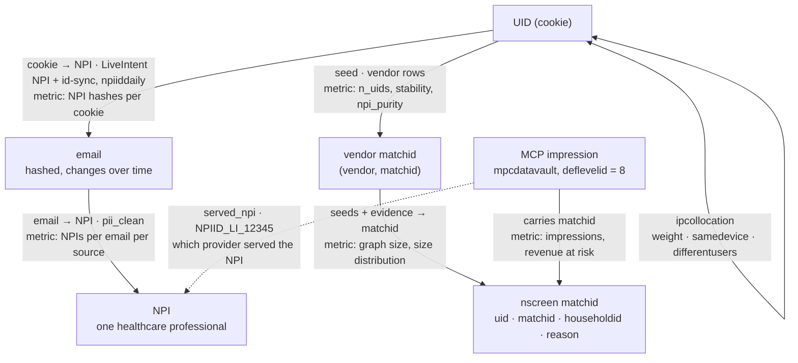
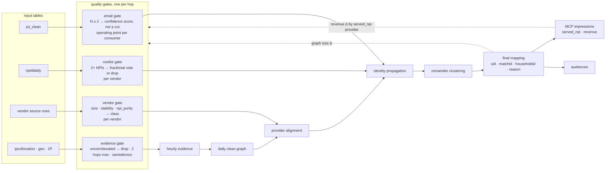
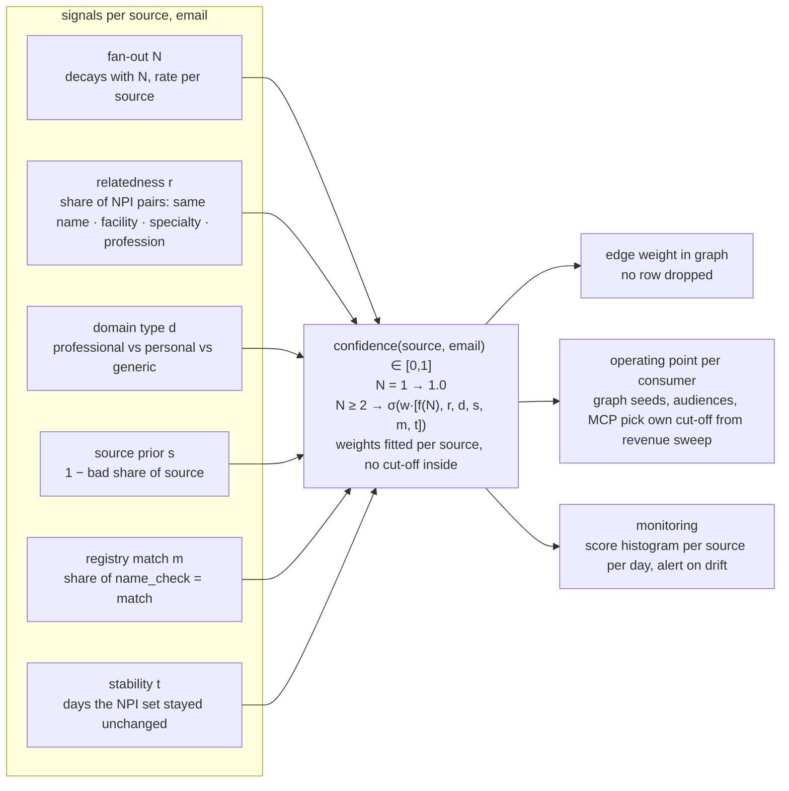
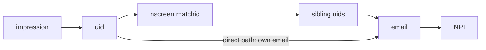
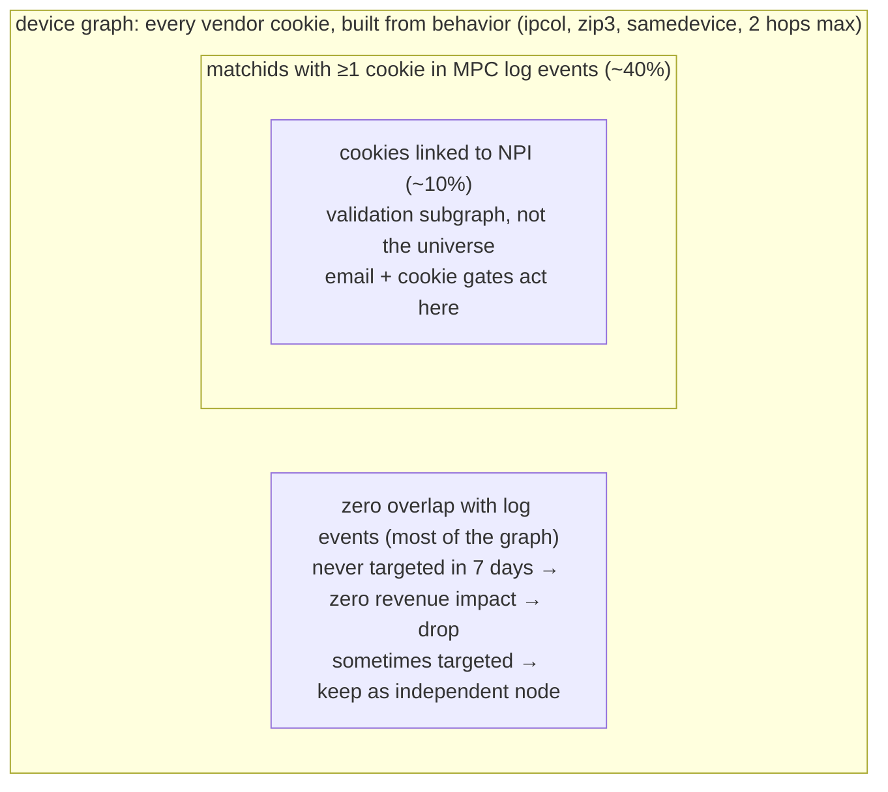

# Identity quality map

How emails, NPIs, cookies, vendor matchids, the nscreen graph and MCP revenue relate, and the one pattern every quality metric follows. Companion to the notebooks in this folder.

## 1. The chain

Every dataset is one hop between two identifiers. The graph grows when a hop fans out.



| hop | provider of rows | metric | where computed |
|---|---|---|---|
| email → NPI | `iceberg.thirdparty.pii_clean` + `npi_reference` (exclude haymarket: not onboarded) | `nd_npi` buckets 1 / 2 / 3–5 / 6+, name vs registry, bad-email rule | `pii_email_npi_density_measurement.ipynb` |
| email over time | `pii_clean` | emails added / removed / changed NPI per source per day | `pii_emails_variation_over_time.ipynb` |
| cookie → NPI | `npiiddaily` | NPI hashes per userid (9.8% multi on 2026-09-28); per vendor share none / single / multi | `vendor_quality_metrics_analysis.ipynb` |
| vendor matchid → UID / NPI | vendor rows, `npiiddaily`, geo_daily (zip3), pii | `n_uids`, `n_emails`, `n_npi` (rename `n_geo` → `n_zip3`), `n_distinct_npis`, `npi_purity`, `npi_quality_score`; density not sums | `vendor_quality_metrics_analysis.ipynb`, `vendor_cookie_crossvalidation.ipynb` |
| UID ↔ UID | ipcollocation | `n_ipcol_uids`, `sum_weight`, same-matchid collocation share | `vendor_cookie_crossvalidation.ipynb` |
| graph → matchid | nscreen-replay | matchid count, size distribution, reason mix, delta vs baseline | `nscreen-replay/` |
| matchid → revenue | `mpcdatavault` deflevel 8 | impressions and revenue on dropped rows, by `served_npi` provider | `recap_bad_email_cleanup.md` |

## 2. One pattern

Each hop asks: how many things on the right does one thing on the left point at?

| hop | 1 : 1 | 1 : few | 1 : many | threshold owner |
|---|---|---|---|---|
| email → NPI | good, score 1 | 2+: confidence score from relatedness, domain, source | score near 0: shared inbox or junk | operating point per consumer, per source |
| cookie → NPI | unambiguous | 2: fractional vote | ambiguous, no vote | per identity vendor |
| vendor matchid → UID | single-device person | household-sized | oversized, low purity | per vendor |
| vendor matchid → NPI | `npi_purity` ≈ 1 | dominant NPI with noise | no dominant NPI | per vendor |
| UID → vendor matchid | one claim | conflicting claims, one vendor | conflicting claims, many vendors | provider alignment |
| nscreen matchid → UID | the output distribution: reducing the graph means pushing this left | | | graph size target |

Thresholds are per source / vendor / provider and come from each one's own distribution (share of 2+, 3+, p99). endato has 1.59% bad emails, haymarket 0%; one constant cannot serve both. Store thresholds as rows `(source, metric, lower, upper, as_of)`.

## 3. Gates in the pipeline



Before a gate goes live: baseline the fan-out per source, score rows, pick the operating point from the score distribution and revenue sweep, replay with and without the gate, price the gate against `mpcdatavault` split by `served_npi` provider.

After: recount daily (emails change), alert on `pii_clean` when a source leaves its band, alert on vendor multi-NPI share and median cluster size, alert on revenue by provider.

## 4. Email → NPI confidence score

One NPI → score 1. Two or more NPIs → score in [0, 1]. No hard threshold in the rule; the cut-off is an operating point each consumer picks from the score distribution and the revenue sweep.



| signal | computed from | pushes score | why |
|---|---|---|---|
| fan-out N | `nd_npi` per (source, email) | down as N grows, e.g. f(N) = exp(−(N−1)/k), k per source | 2,077 NPIs on one email is not a team; the decay rate is learned, not fixed |
| relatedness r | `npi_reference` (name, specialty), `npi_facility_association` (facility), profession | up when NPIs share name, facility, specialty or profession | same name = duplicate record; same facility or specialty = team inbox; neither = unrelated people |
| domain type d | email domain: professional / personal / generic (hosting@, privacy@) | up professional, down personal, hard down generic | hospital department inbox is real; gmail shared by 5 NPIs is wrong data |
| source prior s | 1 − bad share from density notebook | down for endato, rocketreach; neutral for haymarket | replaces per-source threshold: track record is a feature |
| registry match m | `name_check` share per email | down when names do not match registry | pre-filter today; as a feature it stops double counting |
| stability t | `pii_emails_variation_over_time` | up with age | a link that survives weeks is more likely real |

Fitting: labels come from the data. haymarket and medscape 2-NPI same-name emails are positives; endato 10+ NPI and generic addresses are negatives. Logistic regression per source, or a hand-tuned linear mix as first version.

Cut-off: sweep c from 0 to 1, replay the graph and price dropped rows at each step. Plot revenue at risk vs c next to graph size vs c. The curve is the deliverable; each consumer picks its own c on it.

## 5. What a filter costs

An impression earns NPI revenue only if its cookie resolves to an NPI at serve time. Revenue at risk is the revenue on impressions whose only path ran through the removed rows.



| filter level | removes | survives | upper bound | realistic estimate | status |
|---|---|---|---|---|---|
| ① email | (source, email) rows in pii_clean | other emails on the cookie, sibling cookies | all revenue on touched cookies ($270/day) | cookies with no surviving email ($88/day, 0.01% of matchid traffic) | measured, 9 days |
| ② cookie | uid from npiiddaily / vendor rows | nothing for that uid | all NPI revenue on the uid | same, minus revenue mis-attributed to a wrong NPI | not measured |
| ③ matchid | (vendor, matchid) seed cluster | direct email on each uid, re-clustering by collocation | all NPI revenue on cluster uids | uids with no direct email and no re-cluster (needs replay) | not measured |

Same query for all three:

```text
touched_uids  = uids whose path to an NPI passes through rows F removes
surviving     = touched_uids that still reach an NPI through rows F keeps
at_risk       = sum revenue(mpcdatavault, deflevelid = 8, matchid is not null)
                where uid in touched_uids - surviving
                group by day, served_npi provider prefix, filter level, source/vendor
```

Split by `served_npi` provider prefix (`%NPIID_LI_%` = email path). A filter on the email path cannot move revenue another provider served.

With a score instead of a cut, "rows F removes" becomes "rows with confidence below c". Run the query for c in 0.1 steps; plot revenue at risk vs c next to graph size vs c. The knee is the operating point.

## 7. Checked against the Oct 2 review with Ameya

Meeting notes and transcript (Ameya Mahesh Swar and Joel, 2026-10-02) confirm the chain and the per-matchid metrics. The Gemini summary line "match IDs had zero impact on revenue" is a mis-summary: the statement was conditional. A zero-overlap matchid never targeted in a 7-day window has zero revenue impact and can be dropped.



| topic | said on Oct 2 | change in this map |
|---|---|---|
| haymarket | in pii_clean but not onboarded to Throtle / LiveIntent; medscape fully sent; providers filtered before onboarding | exclude from every email metric; density notebook and recap still list it (0 bad, numbers unchanged) |
| NPI as validation | NPI reaches ~10% of cookies; "think of it as if NPI is unknown"; graph must merge on its own from behavior | email + cookie gates validate; evidence gate + never-seen test do the bulk of reduction |
| 2-hop limit | decision: collocation merging chains at most 2 hops, strengthened by samedevice | added to evidence gate |
| density, not sums | summed weight favors big clusters (LiveRamp always wins); quality score picks best vendor at reconciliation (trust matrix) | `sum_weight` is an input; metric is weight per cookie; score feeds reconciliation |
| zip3 | geo_daily = 3-char postal prefix, probably 1:1 (confirm); many zip3 per matchid is signal not proof (VPN); PII zip ≠ log-event zip | rename `n_geo` → `n_zip3`; score input, not a cut |
| stability | no table yet for stable email / stable zip3 per cookie, nor email → NPI change count; 7-day may be too much data | catalog todo; `t` signal in the score |
| contention | same NPI many emails, or matchid with many NPIs: stratified sample, reassign by zip3 similarity, drop ~10-NPI matchids unless cleanly sliceable | matchid → NPI row; score handles slicing |
| uid prefixes | ipcollocation has LR_ uids; check TA_ qualifiers in ipcollocation and geo before joining | open check, affects all collocation metrics |
| Hive writes | 100K matchids failed; iterate by vendor or batch id | done: crossvalidation notebook buckets by hash(vendor, matchid), resumable |

Open action items from Oct 2:

| owner | item | status |
|---|---|---|
| Joel | exclude haymarket from pii_clean metrics | todo, density notebook still includes it |
| Ameya | send LiveIntent source list via Slack | not in repo |
| Joel | confirm geo_daily 1:1 per cookie | not recorded |
| Joel | hash raw pii_clean emails to join LiveIntent cookie → email | not recorded |
| Joel | iterate queries by vendor / batch id | done |
| Joel | push notebook + metric definitions | done |
| Ameya | review definitions | pending |

## 8. The loop, per hop

1. Pick one hop: left identifier, right identifier, table that provides the rows.
2. Count fan-out per owner, bucket 1 / 2 / 3–5 / 6+, split by source / vendor / provider.
3. Score the 1:few band instead of cutting it: fan-out plus relatedness signals into one confidence per row.
4. Keep the cut-off out of the rule: score becomes edge weight; each consumer picks an operating point from the sweep, stored as `(consumer, source, metric, cutoff, as_of)`.
5. Replay with the gate; record matchid count, size distribution, reason mix.
6. Price the gate against `mpcdatavault`, split by `served_npi` provider.
7. Monitor daily; alert on drift; recheck revenue after each change.
