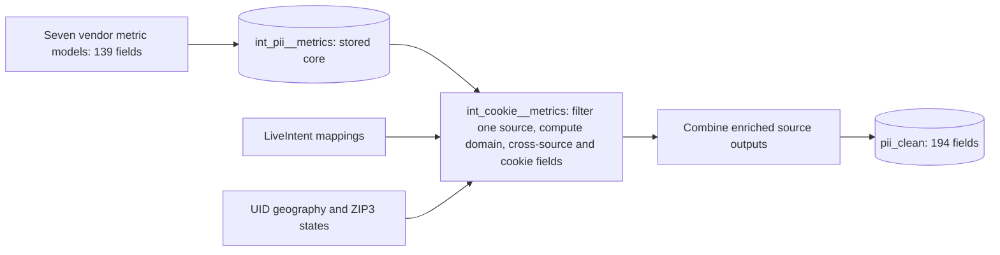

# Independent cookie enrichment

Cookie processing follows stored vendor metrics. Seven `int_<vendor>__metrics` models produce 139 link-grain fields without reading LiveIntent mappings or cookie geography. Their union is materialized as `iceberg.jteixeira_ipa.pii__int_pii__metrics`. The downstream `int_cookie__metrics` model enriches each source independently with 10 domain fields, 14 cross-source fields and 31 computed cookie fields, then combines the 194-field outputs with `UNION ALL`. The stored core remains a cache of non-cookie metrics; source filtering precedes each cookie calculation. All 139 core fields, including stored name explanations, are preserved. Cookie fields are recomputed from the pinned inputs and evaluation window.



The intermediate core is an execution boundary. Cookie enrichment reads stored rows rather than expanding the seven vendor plans again. Core rows contain no cookie columns. The final table receives calculated cookie evidence directly, without placeholder columns or a later MERGE.

## Build commands

From `vendor_quality_measurement/pii_clean`, build source views, stored core and final output:

```bash
../../.venv/bin/python tools/pipeline.py build --direct
```

Resume an interrupted core build, then publish cookies:

```bash
../../.venv/bin/python tools/pipeline.py core --direct --resume
../../.venv/bin/python tools/pipeline.py final
```

`core` uses existing vendor views and writes only non-cookie metrics. Core must match the 139-field contract; `build --direct` rebuilds it from source. `final` and its alias `cookies` pin stored core and cookie inputs, then run seven source-scoped writes. The first source creates/replaces the final table; later sources append their enriched rows. This is the physical equivalent of the model’s `UNION ALL`, without one combined enrichment query. Repeating cookie enrichment does not rebuild vendor attribution or sequential histories.

For a core containing partial Medscape email batches, use `tools/build_medscape_batches.py` first. An incomplete-batch marker blocks ordinary source-level resume. Once that marker is cleared, source-level resume assumes that each existing source is complete. The batch runner validates the full expected link-key and observation-history checksum for each email hash bucket before skipping it. See [build recovery](build_recovery.md).

## Three completed days

The default window is three completed calendar days in America/New_York: evaluation day minus three through evaluation day minus one, inclusive. Today's observations are excluded. Both LiveIntent mapping days and UID geography use this window. For an October 30 evaluation, the window is October 27–29.

`cookie_location_window_days`, start/end dates, available-day counts and missing-day arrays describe the evaluated window on every output link. Integrity checks use the stored window length. This processing window does not establish raw-table retention.

Each source run selects only that vendor’s stored core rows, deduplicates its email hashes, expands mappings into UID/day evidence, resolves UID geography and aggregates to email before joining back to links. An email appearing in two vendor feeds is computed once within each source. The same pinned inputs and window produce the same cookie history; `cookie_vendor_state_evidence` compares it with each link's `source_state_values`, and `cookie_vendor_state_evidence_latest` with `source_state_values_latest` (NULL without a single latest version). Neither repeated email positions nor cross-vendor duplicates multiply final rows.

Separate source batches bound each write and allow source-level recovery. They reread the shared mapping and geography inputs for each source; pinned snapshots coordinate evidence but do not cache cookie results across sources. Source filtering reduces the participating email population, while UID/day expansion remains part of the calculation.

## Validation and failure boundaries

Final publication rejects an incomplete email-batch marker and requires all seven sources and unique `link_id` keys in stored core. Core checksums include all 139 fields, including `computed_at`. Core, LiveIntent, geography and ZIP3 snapshots are pinned for every source batch. Evaluation day, window length and global date coverage are frozen in an atomic table-comment checkpoint. Coverage is captured once with input-snapshot guards. Concurrent core/final changes stop the run. Each committed source must match its complete core population and pass cookie integrity checks; full-population checks precede completion marking. The cross-source fields of a source batch read the stored core of every other source, so each batch sees the same pinned core and the batches stay independent of one another. The integrity checks cover cookie location, domain evidence and cross-source evidence.

Local fixtures cover three-day boundaries, current-day exclusion, duplicate mapping/ZIP rows, tied states, unknown locations and link-specific state comparisons, including the `_latest` comparison. The published table at snapshot `2837737034249693554` carries cookie evidence for 3,000,799 of its 26,732,836 links, from the three completed days October 30 to November 1, 2026 (all three present in both inputs).

## Interrupted source publication

The final development table is partial while source batches are incomplete. Repeat `tools/pipeline.py cookies` to resume automatically from its checkpoint. Existing sources are skipped only after schema, counts, unique keys, every core-field checksum and cookie invariants pass. An uncertain INSERT result is inspected before any subsequent retry. Original input snapshots and evaluation dates are reused; a changed core stops recovery.

[Source-batch publisher](../tools/cookie_publication.py) starts with four fixed writer tasks, local writer scaling disabled and 32 MB target files. Retryable errors allow six attempts with writer counts 4, 4, 2, 2, 1 and 1 and increasing waits capped at 45 seconds. These bounds do not repair HDFS failures. The logical cookie view contains seven source-scoped branches; the runner executes them separately and refreshes that view only after all source outputs pass validation. No extra candidate or per-source result tables are created.

## Validation coverage

Local tests compare combined and source-by-source computation with repeated email positions, ties, unknown locations and missing mappings. They verify that one email in two sources retains identical cookie history while source-specific state comparisons differ. Recovery tests cover incomplete inputs, corrupted retained sources, lost write acknowledgements, changed core snapshots and frozen coverage. [Cookie examples and statistics](metrics/19_cookie_location_evidence.md) describe the population measurements to run after publication.
