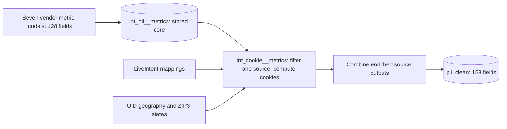

# Independent cookie enrichment

**Published and verified, October 31, 2026:** final snapshot `4233051104478921549` contains 75,656,369 records across seven sources and 158 fields. Source-scoped cookie enrichment preserved all 128 fields from core snapshot `3003274000539755025`, including stored name explanations. Both cookie inputs cover October 28–30 with all three days present. See [stored name evidence](name_match_evidence.md) for recovery and validation details.

Cookie processing follows stored vendor metrics. Seven `int_<vendor>__metrics` models produce 128 fields without reading LiveIntent mappings or cookie geography. Their union is materialized as `iceberg.jteixeira_ipa.pii__int_pii__metrics`. The downstream `int_cookie__metrics` model enriches each source independently with thirty computed cookie fields, then combines the 158-field outputs with `UNION ALL`. The stored core remains a cache of non-cookie metrics; source filtering precedes each cookie calculation. All 128 core fields, including stored name explanations, are preserved. Cookie fields are recomputed from the pinned inputs and evaluation window.



The intermediate core is an execution boundary. Cookie enrichment reads stored rows rather than expanding the seven vendor plans again. Core rows contain no cookie columns. The final table receives calculated cookie evidence directly, without placeholder columns or a later MERGE.

## Build commands

From `vendor_quality_measurement/pii_clean`, build source views, stored core and final output:

```bash
../../.venv/bin/python tools/pipeline.py build --direct
```

Resume an interrupted core build, then publish cookies:

```bash
../../.venv/bin/python tools/pipeline.py core --direct --resume
../../.venv/bin/python tools/pipeline.py final
```

`core` uses existing vendor views and writes only non-cookie metrics. Core must match the 128-field contract. A historical 124-field core requires the [name-evidence upgrade](name_match_evidence.md) or a full source refresh; `build --direct` performs the latter. `final` and its alias `cookies` pin stored core and cookie inputs, then run seven source-scoped writes. The first source creates/replaces the final table; later sources append their enriched rows. This is the physical equivalent of the model’s `UNION ALL`, without one combined enrichment query. Repeating cookie enrichment does not rebuild vendor attribution or sequential histories.

For a core containing partial Medscape email batches, use `tools/build_medscape_batches.py` first. An incomplete-batch marker blocks ordinary source-level resume. Once that marker is cleared, source-level resume assumes that each existing source is complete. The batch runner validates the full expected record-key and observation-history checksum for each email hash bucket before skipping it. See [build recovery](build_recovery.md).

## Three completed days

The default window is three completed calendar days in Europe/Paris: evaluation day minus three through evaluation day minus one, inclusive. Today's observations are excluded. Both LiveIntent mapping days and UID geography use this window. For an October 30 evaluation, the window is October 27–29.

`cookie_location_window_days`, start/end dates, available-day counts and missing-day arrays describe the evaluated window on every output record. Integrity checks use the stored window length, so historical seven-day evidence remains interpretable. This processing window does not establish raw-table retention.

Each source run selects only that vendor’s stored core rows, deduplicates its email hashes, expands mappings into UID/day evidence, resolves UID geography and aggregates to email before joining back to exact vendor records. An email appearing in two vendor feeds is computed once within each source. The same pinned inputs and window produce the same cookie history; vendor/facility state comparisons still use each record’s own attributes. Neither repeated email positions nor cross-vendor duplicates multiply final rows.

Separate source batches bound each write and allow source-level recovery. They reread the shared mapping and geography inputs for each source; pinned snapshots coordinate evidence but do not cache cookie results across sources. Source filtering reduces the participating email population, while UID/day expansion remains part of the calculation.

## Validation and failure boundaries

Final publication rejects an incomplete email-batch marker and requires all seven sources and unique `(source, metric_row_id)` keys in stored core. Non-cookie checksums include all 128 fields, including `computed_at`. Core, LiveIntent, geography and ZIP3 snapshots are pinned for every source batch. Evaluation day, window length and global date coverage are frozen in an atomic table-comment checkpoint. Coverage is captured once with input-snapshot guards. Concurrent core/final changes stop the run. Each committed source must match its complete core population and pass cookie integrity checks; full-population checks precede completion marking.

Local fixtures cover three-day boundaries, current-day exclusion, duplicate mapping/ZIP rows, tied states, unknown locations and record-specific state comparisons. Native Trino executed the three-day synthetic fixture and planned cookie enrichment at 25 fragments. The original October 31 cookie publication completed with 75,656,369 records across all seven sources, preserving every core field and passing cookie integrity checks. Snapshot `8811920360682490090` stores the October 28–30 window and explicit October 30 source gaps. See [execution evidence](build_recovery.md).

## Interrupted source publication

The final development table is partial while source batches are incomplete. Repeat `tools/pipeline.py cookies` to resume automatically from its checkpoint. Existing sources are skipped only after schema, counts, unique keys, every core-field checksum and cookie invariants pass. An uncertain INSERT result is inspected before any subsequent retry. Original input snapshots and evaluation dates are reused; a changed core stops recovery. Ordinary cookie refresh refuses an incomplete name-only backfill. The explicit `cookies --replace-name-backfill` switch can replace it using that backfill’s verified core. It does not clear the old marker before the first cookie source commits.

[Source-batch publisher](../tools/cookie_publication.py) starts with four fixed writer tasks, one writer per task and 32 MB target files. Retryable errors allow six attempts with writer counts 4, 4, 2, 2, 1 and 1 and increasing waits capped at 45 seconds. These bounds do not repair HDFS failures. The logical cookie view contains seven source-scoped branches; the runner executes them separately and refreshes that view only after all source outputs pass validation. No extra candidate or per-source result tables are created.

## Source-batch validation — October 31, 2026

The complete local suite passed 141 tests in 293.70 seconds, including adaptive retries and the explicit switch from an incomplete name-only backfill. Native Trino compared combined and source-by-source computation across 36 synthetic records with repeated email positions, ties, unknown locations and missing mappings: zero differences. Local fixtures additionally verified that one email in two sources retains identical cookie history while source-specific state comparisons differ. All seven source INSERT plans passed at 20 fragments each, and the combined 158-field view passed native type validation. Recovery tests cover incomplete inputs, corrupted retained sources, lost write acknowledgements, changed core snapshots and frozen coverage.

The complete source-batch refresh published snapshot `4233051104478921549`: 75,656,369 records and 158 fields across all seven sources. Every source write succeeded without retry. All 128 core fields, keys and source counts were preserved, including stored name explanations and `computed_at`. Full-population preservation passed in 349.01 seconds; cookie integrity passed in 14.55 seconds. The combined cookie view was refreshed and the completion marker cleared only after these checks.

The October 28–30 window has three available days in each pinned input: mapping snapshot `844438291382994861`, geography `3696066139659628990` and ZIP3 `7123669604605367079`. Stored coverage has no missing dates. The earlier snapshot `8811920360682490090` retains its original two-day coverage; its earlier statistics remain historical.

Native 164-output lookups for three selected emails verified identical values in all 28 cookie-history fields across their respective sources and records. The two vendor/facility comparison fields remain record-specific. The selected emails span three or four vendors each. [Executed lookup cases](email_lookup.md#validation-and-publication-status) and [current cookie examples and statistics](metrics/19_cookie_location_evidence.md) provide the measured evidence.
