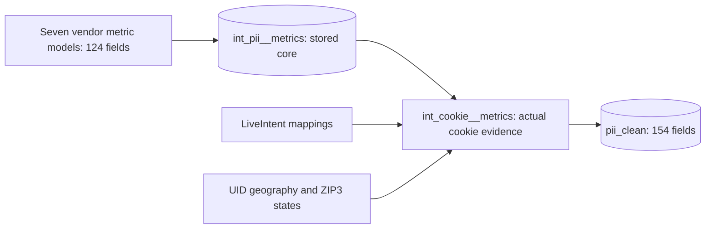

# Independent cookie enrichment

Cookie processing follows stored vendor metrics. Seven `int_<vendor>__metrics` models produce 124 fields without reading LiveIntent mappings or cookie geography. Their union is materialized as `iceberg.jteixeira_ipa.pii__int_pii__metrics`. The downstream `int_cookie__metrics` model adds thirty computed cookie fields and produces the 154-field final contract.



The intermediate core is an execution boundary. Cookie enrichment reads stored rows rather than expanding the seven vendor plans again. Core rows contain no cookie columns. The final table receives calculated cookie evidence directly, without placeholder columns or a later MERGE.

## Build commands

From `vendor_quality_measurement/pii_clean`, build source views, stored core and final output:

```bash
../../.venv/bin/python tools/pipeline.py build --direct
```

Resume an interrupted core build, then publish cookies:

```bash
../../.venv/bin/python tools/pipeline.py core --direct --resume
../../.venv/bin/python tools/pipeline.py final
```

`core` uses existing vendor views and writes only non-cookie metrics. `final` and its alias `cookies` read the stored core, compute cookie evidence and replace the final table. Repeating cookie enrichment does not rebuild vendor attribution or sequential histories.

For a core containing partial Medscape email batches, use `tools/build_medscape_batches.py` first. An incomplete-batch marker blocks ordinary source-level resume. Once that marker is cleared, source-level resume assumes that each existing source is complete. The batch runner validates the full expected record-key and observation-history checksum for each email hash bucket before skipping it. See [build recovery](build_recovery.md).

## Three completed days

The default window is three completed calendar days in Europe/Paris: evaluation day minus three through evaluation day minus one, inclusive. Today's observations are excluded. Both LiveIntent mapping days and UID geography use this window. For an October 30 evaluation, the window is October 27–29.

`cookie_location_window_days`, start/end dates, available-day counts and missing-day arrays describe the evaluated window on every output record. Integrity checks use the stored window length, so historical seven-day evidence remains interpretable. This processing window does not establish raw-table retention.

The model deduplicates email hashes, expands mappings into UID/day evidence, resolves UID geography and aggregates to email before joining back to exact vendor records. Vendor and facility state comparisons use each record's own states. Shared emails do not multiply final rows.

## Validation and failure boundaries

Final publication rejects an incomplete email-batch marker and requires all seven sources and unique `(source, metric_row_id)` keys in stored core. Non-cookie checksums include all 124 fields, including `computed_at`. The core snapshot and evaluation day are pinned for the cookie build. Concurrent core changes are rejected before publication or reported afterward. After publication, schema, row counts, keys and those checksums must match core exactly, and cookie integrity checks must pass.

Local fixtures cover three-day boundaries, current-day exclusion, duplicate mapping/ZIP rows, tied states, unknown locations and record-specific state comparisons. Native Trino executed the three-day synthetic fixture and planned cookie enrichment at 25 fragments. The October 31 publication completed with 75,656,369 records across all seven sources, preserving every core field and passing cookie integrity checks. Snapshot `8811920360682490090` stores the October 28–30 window and explicit October 30 source gaps. See [execution evidence](build_recovery.md).
