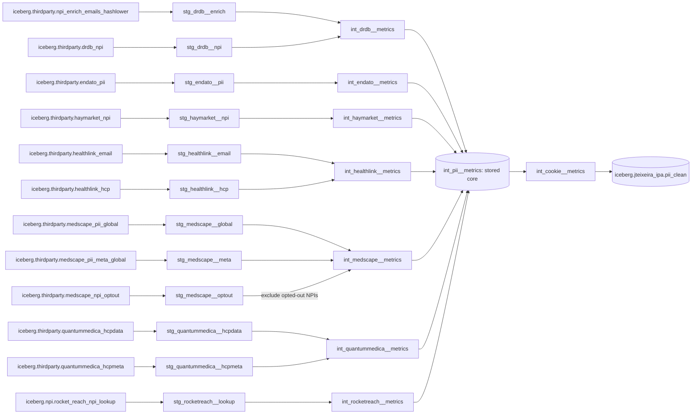
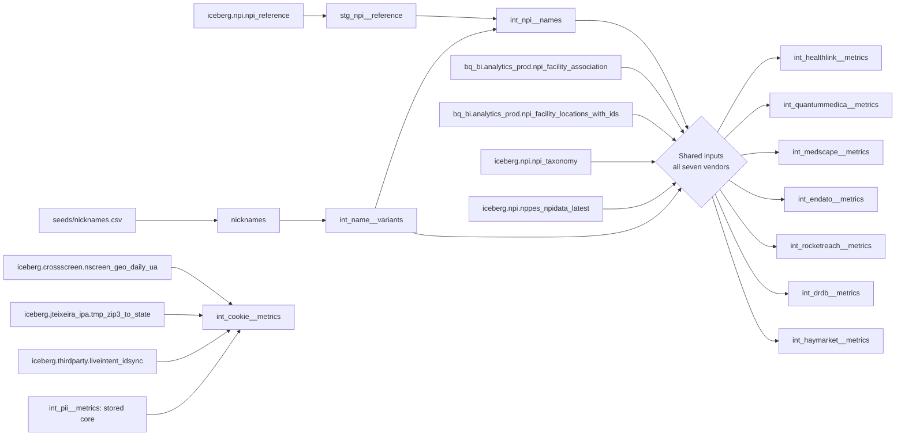
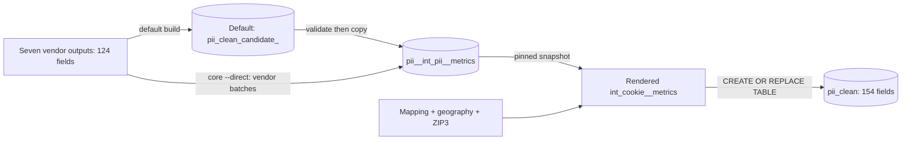

# PII Clean table dependencies

Source and runner inspection: **October 31, 2026**. The direct-dependency table was checked against all rendered models, including macro expansion.

Scope: `vendor_quality_measurement/pii_clean` only. Arrows run from input to consumer. The first two diagrams and dependency table describe logical model inputs. Runtime candidates, stored execution inputs and recovery paths are described separately. The map excludes `pii_clean_v2`, synthetic fixtures, retired cleanup targets and downstream ad hoc queries.

**20 external tables feed 26 project relations:** 13 staging views, 11 intermediate models, one seed view and one final table. Physically, these are **24 views and two stored tables**: `int_pii__metrics` and `pii_clean`. Every staging view has a path to the final model. Medscape opt-outs restrict intermediate eligibility before metrics.

The seven vendor models produce **124 core fields**. Sequential history is calculated within each vendor; registration supersession is calculated within Medscape. Their union is stored before `int_cookie__metrics` adds **30 cookie fields**, using a default three-day window. The final table contains **154 fields**. Cookie sources have no edge into the vendor models.

Model labels below omit `iceberg.jteixeira_ipa.pii__`. The final table is `iceberg.jteixeira_ipa.pii_clean`. External labels retain full names. `nicknames` is a generated view, sourced from `seeds/nicknames.csv`.

## Vendor lineage

Solid arrows show final-output lineage and eligibility dependencies through stored core and downstream cookies. Shared enrichments appear separately below.

`models/intermediate/int_pii__metrics.sql` defines the `UNION ALL` of seven vendor outputs. This stored union is the boundary between attribution and cookie processing. The final SQL model reads `int_cookie__metrics`; the custom runner renders that same cookie model directly into the final table write. Both use the same enrichment logic.

## Shared reference lineage

Every vendor metric model reads both shared name views and four direct reference tables below. The central diamond groups those dependencies for readability; it is not a warehouse relation.

| Shared source | Purpose |
|---|---|
| `iceberg.npi.npi_reference` | Registry names and registry presence, via staging and shared name views. |
| `iceberg.npi.nppes_npidata_latest` | Taxonomy slots, lifecycle status and published NPI entity type. |
| `iceberg.npi.npi_taxonomy` | Validate recognized taxonomy codes. |
| `bq_bi.analytics_prod.npi_facility_association` | Facility-NPI overlap across conflicting NPIs. |
| `bq_bi.analytics_prod.npi_facility_locations_with_ids` | Rank-1 facility state comparison. |
| `iceberg.thirdparty.liveintent_idsync` | Email SHA-256 to namespace/UID mappings. |
| `iceberg.crossscreen.nscreen_geo_daily_ua` | Same-day UID geography. |
| `iceberg.jteixeira_ipa.tmp_zip3_to_state` | ZIP3-to-state lookup. |

The cookie macros also read Iceberg `$partitions` metadata for mapping/geo date coverage. These metadata relations belong to the listed base tables and are not additional independent inputs. Core reference transformations remain inside vendor CTEs. Cookie and geography transformations run in the separate downstream model over stored core metrics. [Workflow](cookie_stage.md).

## Runtime materialization and recovery

The candidate is an optional physical table used by the default core build. It is not a prerequisite for direct builds and is not the stored core itself. The runner creates the 23 upstream views first, then builds core, then creates the cookie view and writes final output.

`core --direct` replaces core with its first vendor batch and appends later batches. `core --direct --resume` retains existing sources after schema, nonempty-source and unique-key checks; it assumes those source batches are complete. The Medscape recovery tool applies stronger expected key/history checks before retaining individual email batches. An incomplete-batch marker blocks ordinary core resume and final publication.

`build_final()` renders `int_cookie__metrics` against one pinned core snapshot and a fixed Europe/Paris evaluation day. It creates the cookie view from that rendered SQL and separately materializes the same SQL into `pii_clean`. The cookie view is not a stored cookie-results table. Final checks compare every core field, including `computed_at`, plus keys and counts, and validate cookie outcomes. The core snapshot must remain unchanged during publication. [Cookie workflow](cookie_stage.md).

Optional warehouse execution inputs are outside the 26 model relations:

| Execution input | Producer and consumer |
|---|---|
| 73-field location input | A vendor model rendered with `defer_quality_enrichments` writes a stored input. `quality_from_stored_records()` attaches freshness, presence/overlap stability, NPI identity and vendor professional evidence. |
| 104-field history input | A vendor model rendered with `defer_sequential_history`, or the preceding quality step, writes a stored input. `history_from_stored_records()` attaches sequence and registration fields before writing the 124-field core. |
| `iceberg.jteixeira_ipa.pii_medscape_versions_<id>` | `build_medscape_batches.py --materialize-records` groups eligible exact raw records after cumulative opt-outs. The same Medscape metric model reads this input in sixteen disjoint email-hash batches and appends full core rows. Metadata and shared reference dependencies remain. |
| Previously validated final snapshot | Recovery can project its 124 non-cookie fields into core for completed sources, with source counts, unique keys and all-field checksums verified against that pinned snapshot. Historical cookie fields are not copied. |

The first two inputs split plans that exceed the stage limit. They are not cookie intermediates. The Medscape input reduces repeated raw-feed scans while preserving all dates, NPIs and GUIDs for each email. Runtime tables are additional materializations, not additional business metrics. Their exact names and validation evidence belong in the [build recovery record](build_recovery.md).

## Last verified publication

The October 31 publication contains **75,656,369 records** across seven sources. Core snapshot `2198246156417274278` has 124 fields; final snapshot `8811920360682490090` has 154 fields. All core fields, counts and keys were preserved. Six source populations were recovered from a validated publication, and Medscape was rebuilt with email batches and the optional exact-record input. The logical diagram therefore does not imply that every upstream source was freshly rebuilt in this publication.

Cookie evaluation used October 28–30, with October 30 absent from both mapping and geography inputs. Missing dates remain explicitly flagged. Shared references were not all snapshot-pinned across Medscape batches. These are dated publication facts, not a live warehouse inventory. [Execution and preservation evidence](build_recovery.md#final-publication-checks).

## Exact direct dependencies

All 83 direct dependencies below were checked against parsed Trino SQL rendered from the 25 SQL models and the nickname seed. This includes macro-expanded and dynamically generated `ref()` calls. Only SQL table references count as dependencies; table names stored as provenance strings do not add direct edges. Model-input labels use the project prefix defined above. External names are fully qualified.

| Model / view | Direct inputs |
|---|---|
| `int_cookie__metrics` | `int_pii__metrics`, `iceberg.thirdparty.liveintent_idsync`, `iceberg.crossscreen.nscreen_geo_daily_ua`, `iceberg.jteixeira_ipa.tmp_zip3_to_state` |
| `int_drdb__metrics` | `bq_bi.analytics_prod.npi_facility_association`, `bq_bi.analytics_prod.npi_facility_locations_with_ids`, `int_name__variants`, `int_npi__names`, `stg_drdb__enrich`, `stg_drdb__npi`, `iceberg.npi.npi_taxonomy`, `iceberg.npi.nppes_npidata_latest` |
| `int_endato__metrics` | `bq_bi.analytics_prod.npi_facility_association`, `bq_bi.analytics_prod.npi_facility_locations_with_ids`, `int_name__variants`, `int_npi__names`, `stg_endato__pii`, `iceberg.npi.npi_taxonomy`, `iceberg.npi.nppes_npidata_latest` |
| `int_haymarket__metrics` | `bq_bi.analytics_prod.npi_facility_association`, `bq_bi.analytics_prod.npi_facility_locations_with_ids`, `int_name__variants`, `int_npi__names`, `stg_haymarket__npi`, `iceberg.npi.npi_taxonomy`, `iceberg.npi.nppes_npidata_latest` |
| `int_healthlink__metrics` | `bq_bi.analytics_prod.npi_facility_association`, `bq_bi.analytics_prod.npi_facility_locations_with_ids`, `int_name__variants`, `int_npi__names`, `stg_healthlink__email`, `stg_healthlink__hcp`, `iceberg.npi.npi_taxonomy`, `iceberg.npi.nppes_npidata_latest` |
| `int_medscape__metrics` | `bq_bi.analytics_prod.npi_facility_association`, `bq_bi.analytics_prod.npi_facility_locations_with_ids`, `int_name__variants`, `int_npi__names`, `stg_medscape__global`, `stg_medscape__meta`, `stg_medscape__optout`, `iceberg.npi.npi_taxonomy`, `iceberg.npi.nppes_npidata_latest` |
| `int_name__variants` | `nicknames` |
| `int_npi__names` | `int_name__variants`, `stg_npi__reference` |
| `int_quantummedica__metrics` | `bq_bi.analytics_prod.npi_facility_association`, `bq_bi.analytics_prod.npi_facility_locations_with_ids`, `int_name__variants`, `int_npi__names`, `stg_quantummedica__hcpdata`, `stg_quantummedica__hcpmeta`, `iceberg.npi.npi_taxonomy`, `iceberg.npi.nppes_npidata_latest` |
| `int_rocketreach__metrics` | `bq_bi.analytics_prod.npi_facility_association`, `bq_bi.analytics_prod.npi_facility_locations_with_ids`, `int_name__variants`, `int_npi__names`, `stg_rocketreach__lookup`, `iceberg.npi.npi_taxonomy`, `iceberg.npi.nppes_npidata_latest` |
| `nicknames` | `seeds/nicknames.csv` |
| `int_pii__metrics` | `int_drdb__metrics`, `int_endato__metrics`, `int_haymarket__metrics`, `int_healthlink__metrics`, `int_medscape__metrics`, `int_quantummedica__metrics`, `int_rocketreach__metrics` |
| `pii_clean` | `int_cookie__metrics` |
| `stg_drdb__enrich` | `iceberg.thirdparty.npi_enrich_emails_hashlower` |
| `stg_drdb__npi` | `iceberg.thirdparty.drdb_npi` |
| `stg_endato__pii` | `iceberg.thirdparty.endato_pii` |
| `stg_haymarket__npi` | `iceberg.thirdparty.haymarket_npi` |
| `stg_healthlink__email` | `iceberg.thirdparty.healthlink_email` |
| `stg_healthlink__hcp` | `iceberg.thirdparty.healthlink_hcp` |
| `stg_medscape__global` | `iceberg.thirdparty.medscape_pii_global` |
| `stg_medscape__meta` | `iceberg.thirdparty.medscape_pii_meta_global` |
| `stg_medscape__optout` | `iceberg.thirdparty.medscape_npi_optout` |
| `stg_npi__reference` | `iceberg.npi.npi_reference` |
| `stg_quantummedica__hcpdata` | `iceberg.thirdparty.quantummedica_hcpdata` |
| `stg_quantummedica__hcpmeta` | `iceberg.thirdparty.quantummedica_hcpmeta` |
| `stg_rocketreach__lookup` | `iceberg.npi.rocket_reach_npi_lookup` |

## Boundaries and verification

- `stg_medscape__optout` excludes all matching cleaned NPIs in Medscape intermediate eligibility. All retained opt-out deliveries contribute without date alignment. Staging remains unchanged. QuantumMedica and Medscape metadata now feed vendor specialty/profession evidence using exact delivery-day joins.
- The logical diagrams describe current model definitions. Runtime alternatives and the dated publication checkpoint are separate. This review did not query deployed view definitions or revalidate warehouse data.
- All 20 declared source tables are referenced by at least one model. All 26 project relations and all 83 direct dependencies match the rendered definitions. Each source and project relation can reach `pii_clean`. No warehouse rows were queried or exported during this review.

Sources: [source declarations](../models/sources.yml), [staging](../models/staging/), [intermediate](../models/intermediate/), [final model](../models/final/pii_clean.sql), [shared macros](../macros/), [runner](../tools/pipeline.py).
