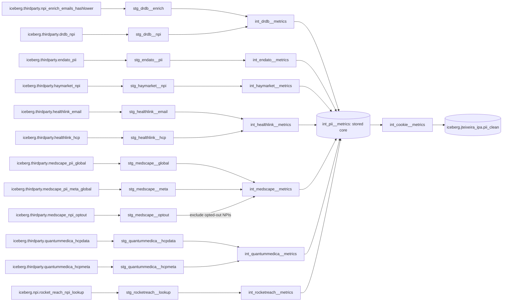
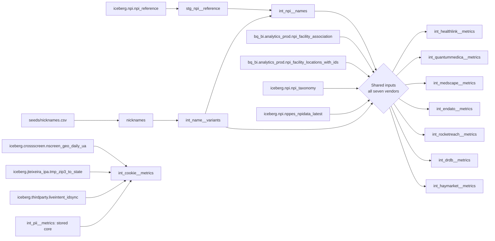
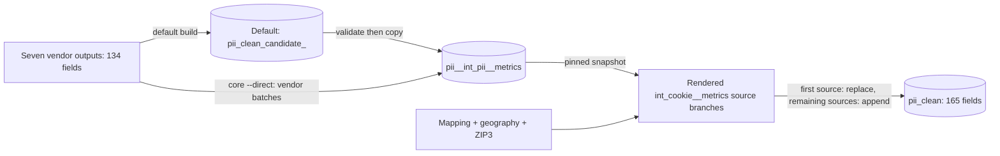

# PII Clean table dependencies

The direct-dependency table is checked against all rendered models, including macro expansion.

Scope: `vendor_quality_measurement/pii_clean` only. Arrows run from input to consumer. The first two diagrams and dependency table describe logical model inputs. Runtime candidates, stored execution inputs and recovery paths are described separately. The map excludes `pii_clean_v2`, synthetic fixtures, retired cleanup targets and downstream ad hoc queries.

**20 external tables feed 26 project relations:** 13 staging views, 11 intermediate models, one seed view and one final table. Physically, these are **24 views and two stored tables**: `int_pii__metrics` and `pii_clean`. Every staging view has a path to the final model. Medscape opt-outs restrict intermediate eligibility before metrics.

The seven-vendor contract defines **134 core fields** at link grain, one row per source/email/NPI, including four stored name-explanation fields. Each vendor model groups raw rows into versions, unfolds email positions and collapses them to links before the shared [link metric chain](../macros/link_metrics.sql). Sequential history is calculated within each vendor; registration supersession is calculated within Medscape. Their union is stored before `int_cookie__metrics` adds **31 cookie fields**, using a default three-day window. The final contract has **165 fields**. Cookie sources have no edge into the vendor models.

Model labels below omit `iceberg.jteixeira_ipa.pii__`. The final table is `iceberg.jteixeira_ipa.pii_clean`. External labels retain full names. `nicknames` is a generated view, sourced from `seeds/nicknames.csv`.

## Vendor lineage

Solid arrows show final-output lineage and eligibility dependencies through stored core and downstream cookies. Shared enrichments appear separately below.

`models/intermediate/int_pii__metrics.sql` defines the `UNION ALL` of seven vendor outputs. This stored union is the boundary between attribution and cookie processing. The final SQL model reads `int_cookie__metrics`, whose source-scoped cookie branches are combined with `UNION ALL`. The custom runner renders one branch per source and appends the enriched outputs into the final table. Both use the same enrichment logic and link grain.

## Shared reference lineage

Every vendor metric model reads both shared name views and four direct reference tables below. The central diamond groups those dependencies for readability; it is not a warehouse relation.

| Shared source | Purpose |
|---|---|
| `iceberg.npi.npi_reference` | Registry names and registry presence, via staging and shared name views. |
| `iceberg.npi.nppes_npidata_latest` | Taxonomy slots, lifecycle status and published NPI entity type. |
| `iceberg.npi.npi_taxonomy` | Validate recognized taxonomy codes. |
| `bq_bi.analytics_prod.npi_facility_association` | Facility-NPI overlap across conflicting NPIs. |
| `bq_bi.analytics_prod.npi_facility_locations_with_ids` | Rank-1 facility state comparison. |
| `iceberg.thirdparty.liveintent_idsync` | Email SHA-256 to namespace/UID mappings. |
| `iceberg.crossscreen.nscreen_geo_daily_ua` | Same-day UID geography. |
| `iceberg.jteixeira_ipa.tmp_zip3_to_state` | ZIP3-to-state lookup. |

The cookie macros also read Iceberg `$partitions` metadata for mapping/geo date coverage. These metadata relations belong to the listed base tables and are not additional independent inputs. Core reference transformations remain inside vendor CTEs. Stored name explanations reuse the shared registry-name join and are aggregated to one row per link; they add no dependencies or output rows. Cookie and geography transformations run in the separate downstream model over stored core metrics. [Workflow](cookie_stage.md).

## Runtime materialization and recovery

The candidate is an optional physical table used by the default core build. It is not a prerequisite for direct builds and is not the stored core itself. The runner creates the 23 upstream views first, then builds core. It renders and writes each cookie source branch directly into final output, validates all source batches and the full population, then refreshes the cookie view and marks publication complete.

`core --direct` replaces core with its first vendor batch and appends later batches. `core --direct --resume` retains existing sources after schema, nonempty-source and unique-key checks; it assumes those source batches are complete. The Medscape recovery tool applies stronger expected key/history checks before retaining individual email batches. An incomplete-batch marker blocks ordinary core resume and final publication.

`build_final()` delegates to [the source-batch cookie publisher](../tools/cookie_publication.py). It pins core and all three cookie input snapshots, freezes evaluation day/window and date coverage, then renders one source at a time through `int_cookie__metrics`. Source filtering occurs before email hashes or cookie mappings are expanded. The first source replaces the final development table, and later sources append. Final is partial until all seven source batches pass schema, count, key, full-core checksum and cookie integrity checks.

The checkpoint is stored atomically in the table comment with the first source. Repeating `cookies` revalidates and skips complete sources, preserving original pins and dates. An uncertain INSERT result is checked before retrying. The logical cookie view is refreshed after completion; it combines all seven source branches but is not a stored cookie-results table. No additional model relations or result tables are introduced. [Cookie workflow](cookie_stage.md).

Optional warehouse execution inputs are outside the 26 model relations:

| Execution input | Producer and consumer |
|---|---|
| Location input | A vendor model rendered with `defer_quality_enrichments` writes a stored input. `quality_from_stored_records()` attaches freshness, presence/overlap stability, NPI identity and vendor professional evidence. |
| History input | A vendor model rendered with `defer_sequential_history`, or the preceding quality step, writes a stored input. `history_from_stored_records()` attaches sequence and registration fields before writing the 134-field core. |
| `iceberg.jteixeira_ipa.pii_medscape_versions_<id>` | `build_medscape_batches.py --materialize-records` groups eligible raw rows into versions after cumulative opt-outs. The same Medscape metric model reads this input in sixteen disjoint email-hash batches, collapses versions to links and appends full core rows. Shared reference dependencies remain. |
| `iceberg.jteixeira_ipa.pii_medscape_prof_meta_<id>` | `build_medscape_batches.py --materialize-records` groups Medscape professional metadata by NPI, day and GUID once; the batches read it instead of the metadata view. |

The first two inputs split plans that exceed the stage limit. They are not cookie intermediates. The Medscape inputs reduce repeated raw-feed scans while preserving all dates, NPIs and GUIDs for each email. Runtime tables are additional materializations, not additional business metrics. Their use and validation are described in [build recovery](build_recovery.md).

## Exact direct dependencies

All 83 direct dependencies below are checked against parsed Trino SQL rendered from the 25 SQL models and the nickname seed. This includes macro-expanded and dynamically generated `ref()` calls. Only SQL table references count as dependencies; table names stored as provenance strings do not add direct edges. Model-input labels use the project prefix defined above. External names are fully qualified.

| Model / view | Direct inputs |
|---|---|
| `int_cookie__metrics` | `int_pii__metrics`, `iceberg.thirdparty.liveintent_idsync`, `iceberg.crossscreen.nscreen_geo_daily_ua`, `iceberg.jteixeira_ipa.tmp_zip3_to_state` |
| `int_drdb__metrics` | `bq_bi.analytics_prod.npi_facility_association`, `bq_bi.analytics_prod.npi_facility_locations_with_ids`, `int_name__variants`, `int_npi__names`, `stg_drdb__enrich`, `stg_drdb__npi`, `iceberg.npi.npi_taxonomy`, `iceberg.npi.nppes_npidata_latest` |
| `int_endato__metrics` | `bq_bi.analytics_prod.npi_facility_association`, `bq_bi.analytics_prod.npi_facility_locations_with_ids`, `int_name__variants`, `int_npi__names`, `stg_endato__pii`, `iceberg.npi.npi_taxonomy`, `iceberg.npi.nppes_npidata_latest` |
| `int_haymarket__metrics` | `bq_bi.analytics_prod.npi_facility_association`, `bq_bi.analytics_prod.npi_facility_locations_with_ids`, `int_name__variants`, `int_npi__names`, `stg_haymarket__npi`, `iceberg.npi.npi_taxonomy`, `iceberg.npi.nppes_npidata_latest` |
| `int_healthlink__metrics` | `bq_bi.analytics_prod.npi_facility_association`, `bq_bi.analytics_prod.npi_facility_locations_with_ids`, `int_name__variants`, `int_npi__names`, `stg_healthlink__email`, `stg_healthlink__hcp`, `iceberg.npi.npi_taxonomy`, `iceberg.npi.nppes_npidata_latest` |
| `int_medscape__metrics` | `bq_bi.analytics_prod.npi_facility_association`, `bq_bi.analytics_prod.npi_facility_locations_with_ids`, `int_name__variants`, `int_npi__names`, `stg_medscape__global`, `stg_medscape__meta`, `stg_medscape__optout`, `iceberg.npi.npi_taxonomy`, `iceberg.npi.nppes_npidata_latest` |
| `int_name__variants` | `nicknames` |
| `int_npi__names` | `int_name__variants`, `stg_npi__reference` |
| `int_quantummedica__metrics` | `bq_bi.analytics_prod.npi_facility_association`, `bq_bi.analytics_prod.npi_facility_locations_with_ids`, `int_name__variants`, `int_npi__names`, `stg_quantummedica__hcpdata`, `stg_quantummedica__hcpmeta`, `iceberg.npi.npi_taxonomy`, `iceberg.npi.nppes_npidata_latest` |
| `int_rocketreach__metrics` | `bq_bi.analytics_prod.npi_facility_association`, `bq_bi.analytics_prod.npi_facility_locations_with_ids`, `int_name__variants`, `int_npi__names`, `stg_rocketreach__lookup`, `iceberg.npi.npi_taxonomy`, `iceberg.npi.nppes_npidata_latest` |
| `nicknames` | `seeds/nicknames.csv` |
| `int_pii__metrics` | `int_drdb__metrics`, `int_endato__metrics`, `int_haymarket__metrics`, `int_healthlink__metrics`, `int_medscape__metrics`, `int_quantummedica__metrics`, `int_rocketreach__metrics` |
| `pii_clean` | `int_cookie__metrics` |
| `stg_drdb__enrich` | `iceberg.thirdparty.npi_enrich_emails_hashlower` |
| `stg_drdb__npi` | `iceberg.thirdparty.drdb_npi` |
| `stg_endato__pii` | `iceberg.thirdparty.endato_pii` |
| `stg_haymarket__npi` | `iceberg.thirdparty.haymarket_npi` |
| `stg_healthlink__email` | `iceberg.thirdparty.healthlink_email` |
| `stg_healthlink__hcp` | `iceberg.thirdparty.healthlink_hcp` |
| `stg_medscape__global` | `iceberg.thirdparty.medscape_pii_global` |
| `stg_medscape__meta` | `iceberg.thirdparty.medscape_pii_meta_global` |
| `stg_medscape__optout` | `iceberg.thirdparty.medscape_npi_optout` |
| `stg_npi__reference` | `iceberg.npi.npi_reference` |
| `stg_quantummedica__hcpdata` | `iceberg.thirdparty.quantummedica_hcpdata` |
| `stg_quantummedica__hcpmeta` | `iceberg.thirdparty.quantummedica_hcpmeta` |
| `stg_rocketreach__lookup` | `iceberg.npi.rocket_reach_npi_lookup` |

## Boundaries and verification

- `stg_medscape__optout` excludes all matching cleaned NPIs in Medscape intermediate eligibility. All retained opt-out deliveries contribute without date alignment. Staging remains unchanged. QuantumMedica and Medscape metadata feed vendor specialty/profession evidence using exact delivery-day joins.
- The logical diagrams describe current model definitions. Runtime alternatives are separate. This map does not query deployed view definitions or warehouse data.
- All 20 declared source tables are referenced by at least one model. All 26 project relations and all 83 direct dependencies match the rendered definitions. Each source and project relation can reach `pii_clean`.

Sources: [source declarations](../models/sources.yml), [staging](../models/staging/), [intermediate](../models/intermediate/), [final model](../models/final/pii_clean.sql), [shared macros](../macros/), [runner](../tools/pipeline.py).
